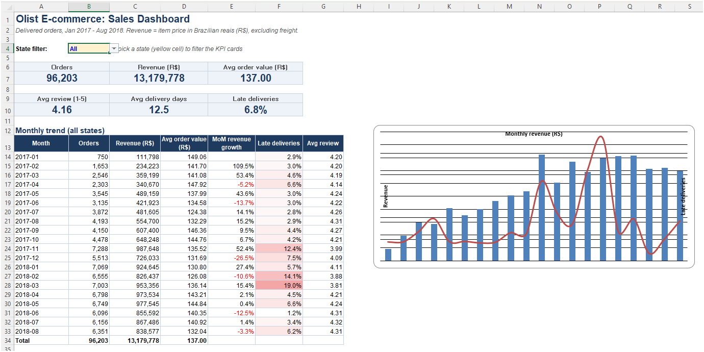
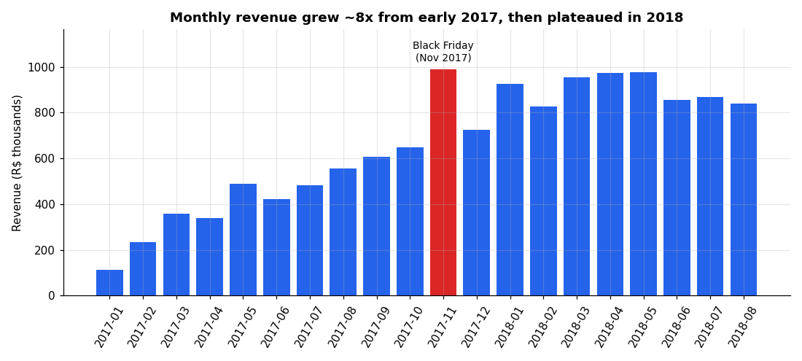
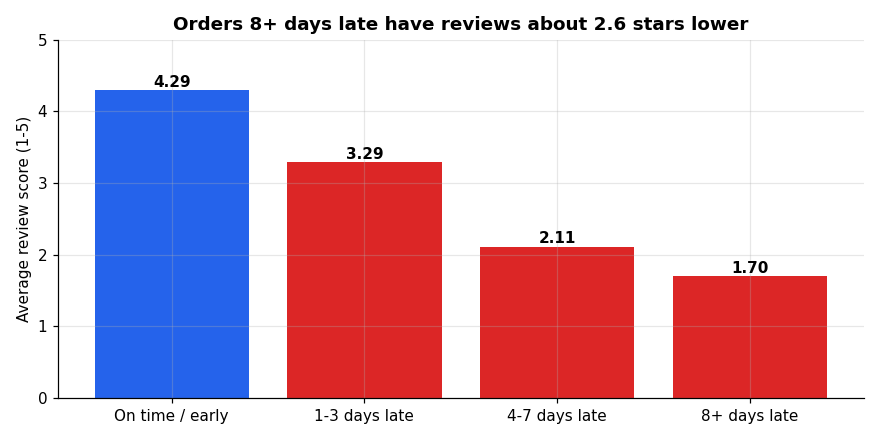
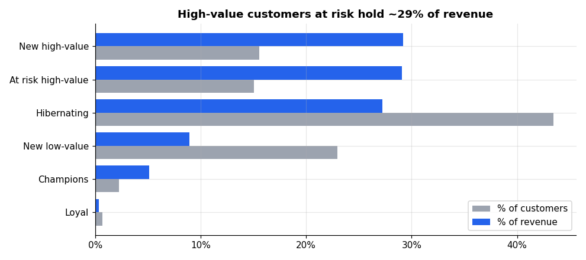

# Retail Sales & Customer Experience Analysis

**SQL · Python · Excel · Power BI**

A personal learning project using **96,203 delivered orders** from Olist, a Brazilian
online marketplace. I used this dataset to practise SQL, Python, Excel and Power BI
on related tables and turn the results into a short retail business analysis.

The focus is on getting the joins and calculations right, building useful reports,
and explaining what the data can and cannot tell us.

**Business question:** Where should a retail team focus to improve delivery reliability
and understand customer purchasing behaviour?

## Dashboards and project links

| Deliverable | Direct link | What you can explore |
|---|---|---|
| **Excel dashboard** | [Download Excel workbook](https://github.com/Adharsh818/data-analytics-portfolio/releases/download/portfolio-v1.2/olist_summary_reviewed.xlsx) | Sales KPIs with a state selector, monthly growth, delivery reviews and category Pareto analysis. |
| **Power BI dashboard** | [Download Power BI package](https://github.com/Adharsh818/data-analytics-portfolio/releases/download/portfolio-v1.2/olist_powerbi_dashboard.zip) · [Opening guide](powerbi/BUILD_GUIDE.md) | Three report pages: Sales Overview, Delivery & Reviews, and Customer Purchasing. Includes the project files and five prepared data tables. |
| **Python analysis** | [View executed notebook](notebooks/olist_analysis.ipynb) | Cleaning decisions, exploratory analysis, customer segments and cohort retention, with saved outputs. |
| **Business summary** | [Read findings and proposed actions](docs/business_summary.md) | A short explanation of the main findings, their limits and the next business questions. |
| **SQL analysis** | [Explore SQL queries](sql/) | Sales, customers, delivery, reviews, payments and sellers. |

**Opening the dashboards:** Excel opens as an `.xlsx` file; the yellow state selector
filters its KPI cards. For Power BI, extract the ZIP, open `powerbi/olist_dashboard.pbip`
in Desktop, set `DataFolder` to the extracted `data/processed/powerbi` folder, and refresh.
The Power BI package is a local Desktop project, not a hosted interactive web report.

**Validation:** SQL, Python and prepared data reconcile; native Excel recalculation and
Power BI refresh/visual interactions still require Desktop checks. See
[validation details](docs/validation.md).

## At a glance

| Delivered orders | Customers | Merchandise sales | Average order value | Late delivery rate |
|---:|---:|---:|---:|---:|
| 96,203 | 93,096 | R$13.18M | R$137.00 | 6.8% |

Analysis period: **January 2017–August 2018**. All monetary values are in Brazilian reais
(R$). Merchandise sales exclude freight and are not profit or marketplace commission revenue.

## Main findings

| Finding | Evidence | Suggested follow-up |
|---|---|---|
| **Delivery lateness is associated with lower reviews.** | On-time orders average **4.29 stars**, versus **1.70** for orders 8+ days late. | Investigate delivery promises, seller dispatch and carrier transit; test changes before estimating impact. |
| **Delivery performance varies by state.** | Late rates are **17.5% in MA**, **13.8% in CE**, **12.1% in RJ** and **4.5% in SP**, among states with at least 500 orders. | Review late-order volume alongside rates to prioritise regional investigations. |
| **Observed repeat purchasing is low.** | About **3.0%** of customers have more than one delivered order in the window. | Test a second-purchase campaign with a control group and equal follow-up time. |
| **Sales have a clear peak period.** | November 2017 merchandise sales were **52.4% above October**. | Compare demand, promises and capacity around peaks; the data does not isolate promotion effects. |
| **Seller sales are concentrated.** | The highest-sales seller decile accounts for approximately **67%** of merchandise sales. | Review high-volume seller performance and investigate quality issues using order-level metrics. |

These are observations and proposed actions, not measured improvements from interventions.

## Excel dashboard screenshot



This is the workbook open in Excel with the state selector set to All. The selector
filters the KPI cards; the monthly table shows all states.

## Analysis previews

### Sales performance



### Delivery and customer reviews



### Customer purchasing



These previews were generated in Python. Download the dashboard files above to explore
the Excel and Power BI versions.

## Skills demonstrated

| Tool | How I used it |
|---|---|
| **SQL / SQLite** | Joined related tables, built clean views, used CTEs and window functions, and calculated monthly growth, customer cohorts and RFM segments. |
| **Python / pandas** | Profiled source data, handled missing values, aggregated transactions, reconciled SQL results and created matplotlib charts. |
| **Excel** | Used COUNTIFS, SUMIFS and AVERAGEIFS for KPIs, a state dropdown, monthly growth, category Pareto analysis and charts. |
| **Power BI** | Defined an order/item model, relationships, Power Query imports and 14 DAX measures across three report pages. |

## Data decisions and learning takeaways

The workflow is raw CSVs → SQLite → pandas analysis → Excel and Power BI. Sales use
delivered orders purchased in the analysis window, with at least one item and a recorded
delivery timestamp. SQL totals are compared with pandas and the prepared dashboard data.

Three useful lessons from checking the analysis:

| Lesson | Example in this project | How it is handled |
|---|---|---|
| **Decide what one row represents before joining.** | An order with two items and two payments can become four rows in a direct join. | Aggregate the tables to order level before joining to calculate sales. |
| **Choose the denominator carefully.** | Orders with several items should not receive extra weight in review averages; missing reviews are not bad reviews. | Count each order once within a category or seller, and calculate review rates using reviewed orders. |
| **A missing observation is different from zero.** | An August 2018 customer cohort has no September follow-up in this dataset. | Leave future retention months blank instead of reporting 0% retention. |

**Checks:** 28 data checks pass, and 41 generated Power BI project/report/platform
definitions conform to Microsoft's public JSON schemas. These structural checks do not execute DAX or Power Query.
Details are in the [validation notes](docs/validation.md) and
[machine-readable results](docs/validation_results.json).

## Scope and limitations

- This is a personal study of historical Brazilian marketplace data. It demonstrates
  methods relevant to retail analytics; it is not work performed for a retailer.
- Delivery/review differences are associations, not causal estimates.
- Cohorts start with the first **observed** purchase in the window. Future follow-up
  months remain blank, and a single purchase does not establish customer churn.
- RFM labels describe the full-window snapshot; segment membership stays fixed when
  Power BI date filters change.
- Inventory, product costs, store staffing and promotion exposure are unavailable.
  Stockouts, margin and promotion uplift cannot be measured from this dataset.
- Itemless orders are excluded from the clean model, so it is unsuitable for an overall
  cancellation-rate calculation.

See the [data dictionary](docs/data_dictionary.md) for table grains and KPI definitions.

## What I would improve next

- Complete the Excel and Power BI Desktop checks and add screenshots of the actual
  dashboard pages. The current README previews are Python charts.
- Compare late-delivery and review patterns within the same product categories and
  states to explore whether the overall pattern holds across different groups.

## Run the project

Tested with Python 3.12 and pandas 2.2. Download the nine source CSVs from the
[Olist Brazilian E-Commerce Public Dataset](https://www.kaggle.com/datasets/olistbr/brazilian-ecommerce)
and extract them into `data/raw/` using their original filenames.

From the repository root:

```bash
python -m pip install -r requirements.txt
python scripts/load_data.py
python scripts/run_sql.py
python scripts/build_notebook.py
python scripts/build_excel.py
python scripts/export_powerbi.py
python scripts/build_powerbi_project.py
python scripts/validate_project.py
python scripts/validate_powerbi.py
```

Excel calculates the rebuilt workbook's formulas when opened. The Power BI builder
sets the local data-folder parameter; regenerate after moving the repository or change
`DataFolder` in Desktop. Schema validation requires internet access on its first run.

## Repository structure

```text
sql/                         Schema, clean views and 18 business queries
scripts/                     Reproducible load, analysis, build and validation scripts
notebooks/                   Executed notebook, Python source and chart images
excel/                       Final Excel dashboard workbook
powerbi/                     Power BI project, model, DAX and opening guide
docs/                        Business summary, data dictionary and validation evidence
data/processed/sql_results/  Small CSV outputs for reviewing the SQL analysis
data/raw/                    Source CSVs downloaded separately; excluded from Git
```

**Data source:** [Brazilian E-Commerce Public Dataset by Olist](https://www.kaggle.com/datasets/olistbr/brazilian-ecommerce).
Raw data, local databases, temporary previews and personal preparation notes are excluded
from the repository's current file tree.
