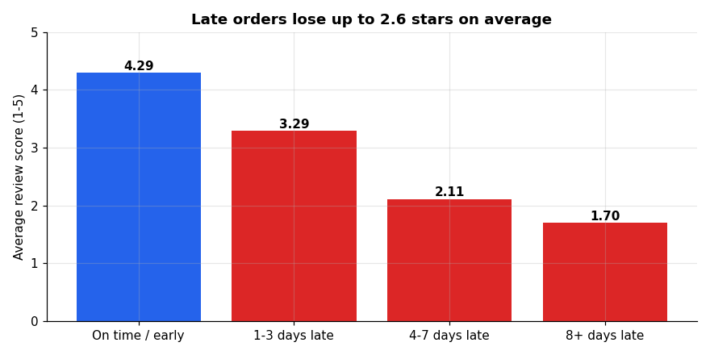

# Olist E-commerce Analytics

End-to-end retail analytics on ~96k delivered orders from Olist, a Brazilian online marketplace
(Jan 2017 - Aug 2018), using **SQL, Python, Excel and Power BI**. The project goes from 9 raw
tables to cleaned data, answers six business questions, and ends with recommendations a retail
team could act on.



## Key insights

| | Finding | Evidence |
|---|---|---|
| 1 | **Late delivery is the biggest driver of bad reviews.** On-time orders average 4.29 stars; orders 8+ days late average 1.70, and 79% of them get 1-2 stars. | [SQL](sql/06_reviews.sql), [notebook §4](notebooks/olist_analysis.ipynb) |
| 2 | **Lateness is regional and seasonal.** Late rates are 17.5% in MA, 13.8% in CE and 12.1% in RJ vs 4.5% in SP, and hit 19% in Mar 2018 after the holiday peak. | [SQL](sql/05_delivery.sql) |
| 3 | **Almost nobody comes back.** 97% of customers order once, and fewer than 1% of any monthly cohort return in a later month. | [SQL](sql/04_customers.sql), [cohort chart](notebooks/figures/cohort_retention.png) |
| 4 | **Growth stalled in 2018.** Monthly revenue grew ~8x through 2017 (Black Friday: +52% MoM) and then flattened at ~R$ 0.83-0.98M a month. | [SQL](sql/03_sales.sql) |
| 5 | **Revenue is concentrated.** The top 10% of sellers earn 67% of revenue; 18 of 74 categories make up 80%. | [SQL](sql/08_sellers.sql), [Excel](excel/olist_summary.xlsx) |
| 6 | **Installments lift basket size.** Credit-card payments in 7+ installments average R$ 332 vs R$ 96 for single payments. | [SQL](sql/07_payments.sql) |

## Recommendations

1. **Fix delivery promises where they break most.** Add carrier capacity or set more realistic
   delivery estimates for the northeast and RJ. A missed promise costs far more stars than a longer one.
2. **Plan logistics capacity before seasonal peaks** (Black Friday, post-holiday), when late rates triple.
3. **Run a second-purchase campaign.** "New high-value" and "At risk high-value" customers are 30% of
   customers and 58% of revenue but have bought only once.
4. **Start a seller quality program** for high-volume sellers with low ratings ([list](sql/08_sellers.sql)).

## Tools and what each one does here

| Tool | Work |
|---|---|
| **SQL** (SQLite) | Schema for 9 tables, cleaned views, 18 business queries with CTEs and window functions (LAG, NTILE, running totals), cohort retention and RFM in pure SQL |
| **Python** (pandas, matplotlib) | Data quality checks, cleaning, RFM segmentation, cohort heatmap, charts, exports for Excel and Power BI |
| **Excel** | Formula-driven dashboard (COUNTIFS / SUMIFS / AVERAGEIFS) with a state filter, monthly trend with MoM growth, state and category Pareto sheets, conditional formatting, charts |
| **Power BI** | Star schema (2 facts, 3 dimensions), 15 DAX measures, 3-page dashboard: sales, delivery and satisfaction, customers |

## Repository structure

```
sql/
  01_schema.sql          table definitions
  02_clean_views.sql     cleaning rules as views (analysis window, delivered orders, category fixes)
  03-08_*.sql            one file per business question
notebooks/
  olist_analysis.ipynb   Python analysis (rendered with outputs)
  figures/               charts used in this README
excel/olist_summary.xlsx Excel dashboard workbook
powerbi/
  measures.dax           DAX measures
  BUILD_GUIDE.md         model, pages and expected numbers for the dashboard
scripts/                 load_data, run_sql, build_notebook, build_excel, export_powerbi
data/processed/sql_results/  CSV output of every SQL query
```

## Data

[Brazilian E-Commerce Public Dataset by Olist](https://www.kaggle.com/datasets/olistbr/brazilian-ecommerce)
on Kaggle: 9 related tables covering orders, items, payments, reviews, customers, sellers,
products and geolocation. Raw files are not committed; download the zip and extract the CSVs into `data/raw/`.

**Cleaning decisions** (see [02_clean_views.sql](sql/02_clean_views.sql)):
- Analysis window is Jan 2017 - Aug 2018; 2016 and Sep-Oct 2018 have too few orders.
- Revenue = item price of delivered orders, excluding freight.
- 775 orders with no items are dropped; orders with several reviews use the average score.
- 610 products without a category are labelled `unknown`; 2 untranslated categories are translated manually.
- Customers are counted by `customer_unique_id`, because `customer_id` changes with every order.

## Business questions

1. **Sales:** How have revenue and orders trended? Which categories and states drive revenue?
2. **Customers:** How many customers buy again? How do monthly cohorts retain? Who are the high-value customers?
3. **Delivery:** How often are orders late versus the promised date, and where?
4. **Satisfaction:** How does late delivery affect review scores? Which categories get the worst reviews?
5. **Payments:** How do payment type and installments relate to order value?
6. **Sellers:** How concentrated is seller revenue, and which sellers hurt customer experience?

## How to reproduce

```bash
pip install pandas matplotlib openpyxl
python scripts/load_data.py        # data/raw/*.csv -> data/processed/olist.db
python scripts/run_sql.py          # runs every query, saves results to data/processed/sql_results/
python scripts/build_notebook.py   # executes the notebook and exports clean tables
python scripts/build_excel.py      # builds excel/olist_summary.xlsx
python scripts/export_powerbi.py   # star schema for Power BI (see powerbi/BUILD_GUIDE.md)
```
